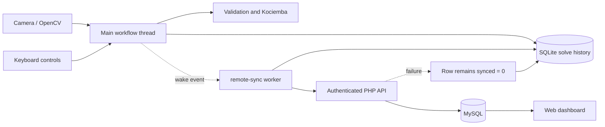
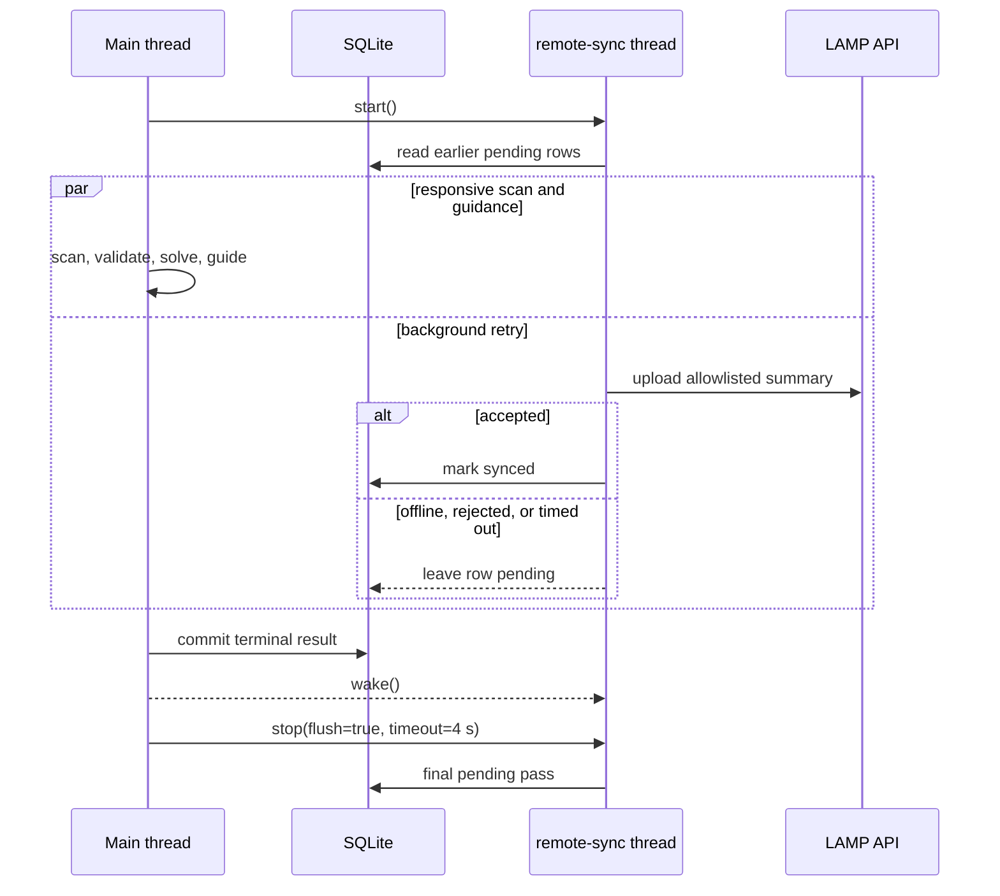

# Runtime architecture

The application is a modular Python program with one narrow concurrency boundary. The
main thread owns the camera, OpenCV windows, validation, solution, move guidance, and
durable local recording. The `remote-sync` daemon thread owns potentially slow HTTP
communication.

## Synchronisation lifecycle

## Concurrency rules

- SQLite is the durable queue; solve payloads are never held only in thread memory.
- `threading.Event` provides wake-up and shutdown signalling.
- A lock prevents two retry passes from running at the same time.
- Starting an already-running worker is idempotent and does not create another thread.
- Upload errors are contained by the worker and cannot abort the scanner.
- Shutdown waits for no more than four seconds. If work is unfinished, the local row
  remains pending for a future run.
- Camera threading is intentionally excluded because OpenCV GUI operations are most
  reliable on the main thread and the measured risk is network I/O, not frame capture.
